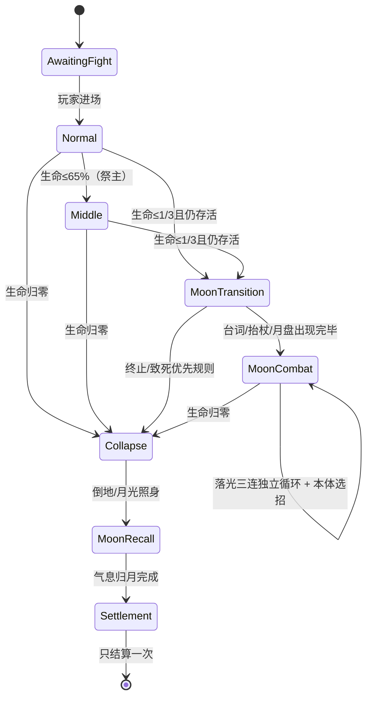

# 前三位 Boss 重做与近战转身规范（已确认并实现）

本规范依据 2026-10-27 用户本轮要求。用户于2026-10-27回复“实现”授权执行；当前实现与验证记录见 boss-reset-implementation-plan.md。

## 目标与范围

前三位 Boss 重做技能主题和动作，第四位仅修改步战连招转身规则并补相应动作帧；保留第五位狮叟、主角/牛大侠、战意倍率、月露、难度模式及连战顺序。视觉沿用游戏内简洁像素原画 + 2D 关键帧和网格小幅过渡。交付须有真实渲染动作视频与音效验证，不以重命名或改色替代完整重做。

## 重做前实现证据

| 观察 | 当前实现 | 要解决的问题 |
|---|---|---|
| 第一位仍叫守灯兽 | `data/bosses/lantern.tres`；现图四足鹿角兽，胸前有灯坠 | 名称与视觉都需转为守石兽；只有原有地面冲击明确关联石头 |
| 前三位不断追踪朝向 | `boss.gd::_physics_process` 每帧更新 facing；`execute_event(close_slash)` 每刀重新读取目标方向 | 背后绕行失去价值，连招反复瞬间转身 |
| 祭主近战低矮 | 连段统一生成 y=400、高50的矩形；突进区域 y=415、高35 | 伤害与肩臂、手杖动作脱节，不能只把全身画面压低 |
| 祭主提示过度 | `draw_priest_warning` 绘制红色危险框、青色安全框、圆形倒计时、感叹号 | 删去这些信息图形，改用角色及法术本身的动作 |
| 祭主旧三阶段 | 65% / 30% 血量，第三段“噬月终仪” | 第三段改为 ≤1/3 血量的“月亮形态” |
| 死亡很快结束 | 旧 Boss 1.3秒淡出，连战死亡后2.4秒结算 | 归月演出必须拥有完整结束时机，不能让普通死亡淡出或胜利结算先执行 |
| 原三位关键帧少 | `assets/art/boss_frames` 共18张，每位6张 | 不能靠六张图大幅拉网格假装增加关键帧 |
| 骑士也存在分段追踪 | `knight.gd::lock_for_dash`、枪法段间与 `knight_spear.gd::advance` 会再次锁向 | 步战所有近战链纳入同一概率规则；保留马战原有承诺式冲锋 |

数值基线：守石兽1500生命、第二位2600生命、祭主3600生命。第二位当前单段伤害12–30、主要前摇0.65–0.9秒。所有新数值是下文的设计初值，不是已经验证的平衡结果。

## 需求

### R01：名称与身份

第一位所有玩家可见名称统一为“守石兽”，包括血条、关卡入口、台词署名、图鉴、败因与说明；原显示“守灯石庭”的场地改为“守石庭”。内部 `lantern` ID保留以兼容既有流程与记录，不能因改名丢存档。外形保留辨识度高的四足/角冠轮廓，但去掉灯坠和皮毛主导的表现，改为灰石躯干、板状肩背、石质关节与少量大块接缝。

第二位明确是河边剑士，保留暗红衣、面具和河岸场景，主要攻击来自剑的直线突刺与实体飞镖。用户未要求改第二、三位专名，因此暂沿用“渡影刀客”“噬月祭主”的显示名；招式表现按剑士和月亮祭司重做。

### R02：守石兽控石与身体进攻

地面石块必须经历松动、抬起/滚动、发力、实际命中、碎裂或落地，不能突然出现伤害区。保留接近现有的扑进；近身角顶/肩撞/踏击带小幅踏进。具体7招见 `stone-guardian-reset-design.md`。

### R03：河边剑士保持强度级别

保持2600生命、原有12–30单段伤害级别与前摇/反击窗口级别。8招丰富距离和节奏，但不把原七招叠成更长的必吃连段，不额外加霸体、全场追踪或无提示瞬移。新招替换原选招权重，不简单增加单位时间攻击次数。具体见 `river-duelist-reset-design.md`。

### R04：祭主所有攻击成为月亮能力

原角冲、四连、地裂、落雷、幽火、追魂、灵束、悬刃雨、换位、大阵分别重制为月杖/弦月/落光/月影体系。禁止锯齿雷电、雷音、火焰与岩石地裂继续出现在祭主的攻击中；也同步修改技能名、败因提示、声音身份和图鉴，不只换颜色。羊灵和其他角色原有能力不因此改变。

### R05：手杖追砍

祭主从肩胸高度举杖，踏步后以杖头走斜下、前挑和回收弧线。命中位置来自实际杖头和杖身扫过的范围，覆盖站立羊小侠需要的高度，而不是将角色、手臂和全部特效压到地上。每段接近有行程上限；跑出本段范围就挥空，不把判定瞬移到玩家身上。

### R06：每套近战连招抽一次转身机会

| Boss | 追踪主角到背后的连招转身概率 |
|---|---:|
| 守石兽 | 25% |
| 河边剑士 | 25% |
| 噬月祭主 | 40% |
| 断誓枪骑步战 | 65% |

定义：在整套近战开始时抽一次伯努利结果。本套最多使用一次转身；只在当前一击收回、下一击尚未发力的段间窗口且羊小侠确实来到背后时触发。未抽中则本套始终保留原朝向，不能后续每帧重抽；玩家又绕回正面不消耗机会。单击突进承诺后不能转向，闲置/整套收招后重新面向玩家不计入该概率。判定对象是羊小侠，不会因牛大侠站在另一侧而反复翻面。

转身需要可见的挪足、髋肩带动、兵器收回与再抬手；转身期间无近战伤害。建议各自转身时长石兽0.26s、剑士0.20s、祭主0.26s、骑士0.24s，原出手时刻相应顺延，不能转身动画未完就命中。步战旋身招中预编排的旋转动作不是自动追踪，仍按招式本身走固定轨迹。骑士马战、弓箭逐发瞄准与第五位不套用本规则。

### R07：动画与美术完成标准

前三位独立新姿态数量至少达到现骑士约72张的级别；设计目标为守石兽98、剑士108、祭主156张。骑士在原有素材上另补28张步战转身/步伐/收枪过渡。计数只统计实际绘制的不同姿态，不把重复PNG、翻转图、运行时变形或插值采样当作新关键帧。

每招完整覆盖守势→移重心→蓄力→蓄力顶点→兵器先行→命中→跟随→制动→回收→回到守势。大动作增加额外中间帧，网格只补小过渡；兵器刚性、手与柄连接、脚底接地、转身左右镜像均需实机检查。统一少量大色块与主褶，不添加纹饰、刺绣或细碎材质噪点。具体逐招清单见三个设计文件。

### R08：自然预兆

删除祭主的红/蓝危险框、青色安全区框、感叹号、倒计时和箭头。举杖、身体蓄力、袍摆、杖端月华、真实淡光、月尘流动与起手声音提供信息。危险发生前必须能从实际攻击本体读出方向与节奏，禁止通过隐藏前摇或使预兆不可见来提高难度。地面标记不另行增加。安全空间以未被月华占据的暗处表达，不画绿色“答案框”。

### R09：月亮形态阈值与台词

血量首次降至 ≤最大生命1/3 时进入一次性转换（默认3600生命即1200）；65%原有中段保留为节奏变化，角色仍是原形。转换清除旧攻击、独立计时与已锁位置，保留玩家站位重整时间。祭主抬杖仰望，声音与月盘出现同步；台词拟为：“借一轮月，照尽归途。”

这一句优先于祭主自己的普通台词，不吞掉转换事件；若正有同伴语音，祭主先停步起势，待同伴说完再正式说出这一句，之后完成月盘显形，不抢断同伴，也不让语音迟到形态之后。正常转换设计约2.4秒，起势等待不重复触发或重新抽取，主角可趁机重新站位。暂停冻结演出。转换后状态名固定为“月亮形态”，Boss仍在地面，可被主角和牛大侠攻击，不增加第二条生命。

### R10：巨大月亮与月华环绕

月盘在画面上方中间显现，设计直径约200–220个HUD逻辑像素；镜头和屏幕比例改变时仍保持该构图。以大块明暗月面、薄月晕和少量月尘形成完整月球，不用实心白圆或巨大泛白遮住角色。HUD在上层，必要时用局部暗底保持生命信息清楚。

祭主身边持续有5–7条前后错层月华带和受限数量的月尘，跟随身体、手杖和袍摆运动。日常环绕不产生伤害，不能与落光的危险主体混淆；发力时由其中一条汇入杖端，收招后重新散开。

### R11：三道落光的完整时间线

每一束在预兆开始时读取羊小侠当前位置并固定该落点，不锁牛大侠，不在发光后继续追随。由巨大月盘方向落向这个位置，先有透明的浅银光和地面柔和照明，随后凝成明亮、笔直、没有锯齿分叉的月光柱。内部伤害判定可以是几何区域，但屏幕不能绘制该判定框。

设计初值：预兆0.60s，其中前0.38s是淡光，随后0.22s月丝收束；明亮核心持续0.12s，仅这一段能伤害；余辉0.26s无伤害。默认宽46px，画面核心/边辉与判定边缘一致；不额外增加看不见的外扩伤害。原三连普通招保留24伤害级别。

### R12：月亮形态的落光独立循环

每2.8s发出一组3束（组内启动间隔0.55s），进入形态后一直循环，直到战斗结束或被暂停；不占用祭主自身选招、挥杖、位移与施法的时间线。初值每束18伤害，增加压力来自持续叠加，而非简单提高单次伤害。

同屏最多两道预兆、一束伤害核心；不预先将整场地填满。常规选招在可见出手与落光之间留可通行的路径。大范围雨/大阵如果与月光核心共同覆盖唯一出口，则顺延祭主自身释放拍子，落光循环继续；不自动给玩家画安全区。已发出光束不改变落点，也不根据玩家按键临时移位。

### R13：战败后的归月演出

生命归零的优先级高于任何新阶段或新攻击。立刻停止所有伤害、普通选招、独立月光循环和同伴攻击，冻结玩家战斗输入，清理实体/飞行物/延迟事件。Boss身体先完整倒地，月亮留在场上。若一次大伤害跨过形态阈值直接击败，也照样出现月盘接回气息，不强制先插播变身再死亡。

演出设计约6.4s：

| 时间 | 画面与声音 | 状态 |
|---|---|---|
| 0–0.7s | 手杖脱力、膝部失衡、躯干倒地、布料和杖落地声 | 保留尸身，不做普通1.3秒淡出 |
| 0.7–1.3s | 镜头轻收、上下电影遮幅、HUD退出、场景压暗，月光照住倒地身体 | 战斗结束，尚未结算 |
| 1.3–4.7s | 躯体轮廓从边缘散成柔和气息，数缕弧线缓慢汇向月盘；手杖最后消散 | 暗示回归、保留后续复活空间 |
| 4.7–5.8s | 最后一缕气息被月亮接住，月面轻亮一次，留一拍安静 | 不碎裂、不爆炸、不宣布魂灭 |
| 5.8–6.4s | 月盘隐入夜空，遮幅退出，恢复过渡至结算 | 完成一次性通关结算 |

拟定轻声台词：“此身……暂归月下。”不直接宣布不死或后续复活剧情。剧情不可被旧2.4秒结算计时截断。暂停可用，暂停时声画冻结；若提供跳过，必须跳至完整清理和单次结算终点，不能跳回战斗或重复发奖励。

### R14：声画完整

每招有起手、蓄力、释放、实际命中、落地/收招的独立声音事件；连段每段分别触发，挥空不播命中声。石兽是石块摩擦/滚动/碎裂/沉重脚步，剑士是步法/衣摆/剑锋/金属飞镖，祭主是轻金属杖鸣/气流/低共鸣/月光脉冲，绝不保留电击雷声。每个角色对白覆盖登场、阶段、每招、被化解、玩家重伤、自身低血与败退，每事件多句，普通台词间隔至少12秒。台词目录另附 `boss-reset-dialogue-draft.md`；须有实际音频后才能算实现完成。

### R15：可调与兼容

生命、招式伤害、各段前摇、行程、速度、收招、四个转身概率与转身耗时、月华宽度/锁点时机/三连节拍、月亮形态阈值和演出时长均接F2。原 `lantern/duelist/priest/knight` 身份及连战存档序号不变，已有武学/月露/牛大侠/标准和从容模式不变。旧“雷击”败因迁移为“月光”，旧历史统计不清空。

### R16：验收

1. 名称检查与美术并排截图；关键帧实物清点（98/108/156，骑士补28）；普通/大动作相邻帧脚底、武器尖、手柄无突跳和穿模。
2. 每招可以被选中；前摇无伤、判定贴合实际兵器/石块/月光；同一段对同一目标只结算一次；左右朝向正确。
3. 概率使用可注入随机数：阈值上下边界、同套重复绕后只抽一次/只转一次、不抽中保持原方向、空闲能转向、突进中禁止改向。大量固定种子采样接近25/25/40/65%，确保不是每刀概率累计。
4. 第二位使用相同玩家策略、战意规则、牛大侠配置和固定种子，与本次修改前基线比较：生命及原伤害级别不变，持续攻击密度不增加；目标通关中位耗时变化≤15%、固定策略死亡率差≤10个百分点。不达标调整选招权重、间隔和收招，而非暗削主角。
5. 精确1200阈值、跨阈值大伤害、暂停、同时换阶段与受击、进入形态一次；落光固定初始位置，0.60秒前和余辉不伤人，三束独立循环与普通攻击可同时推进。
6. 合成覆盖测试：靠墙/绕背/空中/骑牛时仍存在真实躲避路径；大范围组合不得封死出口；不靠彩色安全框提示答案。
7. 败北取消所有已排队/月光/弹道伤害；倒地后无新锁定；完整归月结束前不弹结算，结束后奖励与存档只写一次。退出/重试无月盘残留。
8. 所有音频文件可加载、逐段事件完整，试听确认不残留雷声；真实后台静默渲染录制第一/二位全部招式、祭主普通与月亮形态，以及完整归月结尾。音频另用离线试听验证，不以静音录屏宣称听过。

## 状态与边界

暂停是上述每个可运行状态的暂停层，不重新初始化随机数或定时器。退出/切关/重试立即清理所有状态所有者。第一、二位沿用普通败退；第四位只改变步战转身和相关动画，不重写马战或幽军。

## 确认记录

用户已回复“实现”，确认本文件和三份逐招设计中的新增招式、转身“每套最多一次”的解释、月亮持续落光节奏与归月结尾时间。用户已明确的25/25/40/65%、1/3阈值、淡光再亮光及归月剧情不作为可随意替换的方案。

## 调研来源：四种媒介与库外来源

以下是来源支持的事实与本次创作推导，推导是原创设计取舍，不声称来源中存在相同招式。跨动作游戏、MOBA、电影、神话文字四种媒介，额外查阅真实击剑；《侠女》、FIE技术规则、Werner神话书均不在项目列出的具体参考作品中。

| 来源 | 动作 | 节奏 | 人物 | 玩家回答 / 本次迁移 |
|---|---|---|---|---|
| [《师父》开发团队谈战斗](https://blog.playstation.com/2021/11/18/how-sifus-kung-fu-combat-works/) | 开发者强调真实技法、可信动作与美感的平衡 | 攻防往返、可被读懂的支撑关系 | 角色以身体承担进攻风险 | 本次推导：石兽重心、剑士承接前脚、祭主举杖和收杖都要完整；只借可信身体和攻防交换，不复制架势系统 |
| [Riot：岩雀官方能力页](https://www.leagueoflegends.com/en-ph/champions/taliyah/) | 岩块由地面抽取，实体投出；地面与岩块有关系 | 施法形成来源，再释放为运动物体 | 控石者的能力和所在大地相连 | 本次推导：守石兽“掀石→托石→掷石/滚石”因果明确；不移植岩雀整套招式、地雷或数值 |
| [BFI：《侠女》](https://player.bfi.org.uk/subscription/film/watch-a-touch-of-zen-1971-online) 与 [影片馆藏说明](https://nfi.hu/en/budapest-classics-film-marathon-2024/screenings-2024/programme-sections-2024/open-archives-2024/women-with-swords-action-heroines-in-taiwanese-cinema/a-touch-of-zen.html) | 剑斗与竹林空间构成清楚的身体穿行；影片结合武打与佛教/超自然意象 | 静止、突然发力、再静止的创作参考 | 武人和超自然存在有不同的在场感 | 本次推导：剑士雾中错步有等待与穿刺，祭主结尾从打斗转为静默归月；不靠电影剪辑省去游戏里的中间帧 |
| [E.T.C. Werner：《Myths & Legends of China》](https://www.gutenberg.org/cache/epub/15250/pg15250-images.html) 与 [月球与行星研究所：月亮故事](https://www.lpi.usra.edu/education/explore/marvelMoon/tales/) | 神话文字中存在登月、月居与仙灵的意象，书中另有神话石材意象 | 由尘世行动转向天体的叙事节拍 | 月亮可成为归处，不只是背景圆形 | 本次推导：祭主气息有实际方向地归于月；只迁移意象，不引入嫦娥、后羿或新神祇，也不将用户的复活剧情误称为原典内容 |
| [FIE：2024技术规则 t.101](https://static.fie.org/uploads/37/185366-technical%20rules%20ang.pdf) | 剑尖/持剑臂先形成威胁，弓步由腿推动，前足承接与触击有先后 | 直刺是一条连续、承诺式动作链 | 兵器手与身体位置有责任，不能已刺出又随意掉头 | 本次推导：剑士D1先手腕对线→后腿送出→前脚承接→回剑；仅借动作逻辑，不把竞技判罚当游戏规则 |

以上是设计调研，不是已完成的招式实现、动画生成、配音或实机平衡验证。

## 骑士步战补帧明细（新增28张）

现有马战/步战所有招式保留，范围只补全本轮转身与承诺规则需要的姿态：

- 转身8张：收枪尖、移重心、前脚抬起、髋部转半身、肩臂带枪过中线、后脚落稳、枪尖重新对线、恢复迎敌。不能只瞬间镜像贴图；转身中不结算近战。
- 短踏进6张：后脚压地、前脚卸重、身体推送、前掌承接、后脚跟进、双脚站稳；用于各段之间接近，按实际行程播放，不滑步。
- 蓄枪到出手6张：枪回肩侧、手肘后收、肩胯加载、枪尖先送、胸肩跟随、前臂完全伸展；命中只能从对应出枪姿态开始。
- 随枪到收势8张：枪身送足、前膝吸收、后肩制动、肘部回抽、枪尖回身、腰胯复位、足跟放稳、枪回守位；本套被抽为不转身时也不能在这些帧里偷偷翻面。

对于原本就有固定旋转的枪法，旋转轨迹保持原招定义；不能把持续“追踪玩家”伪装成一个可绕过65%限制的新转身入口。随机概率验收以每套都在合法段间窗口触发一次绕背的可比场景进行，不用“玩家从未绕背”的样本稀释统计。
